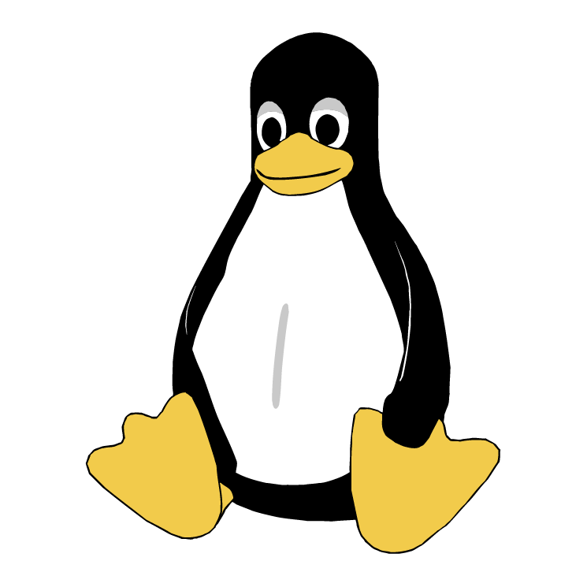
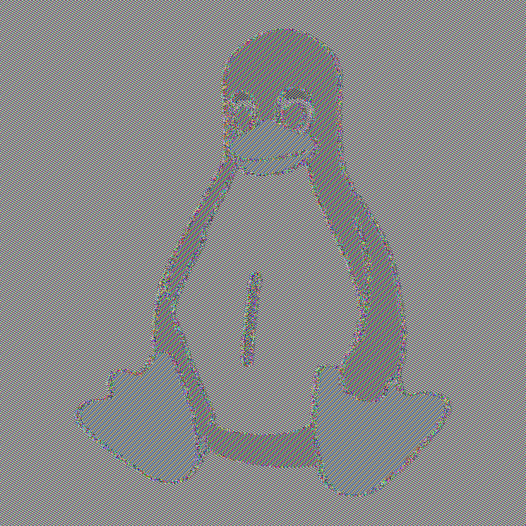
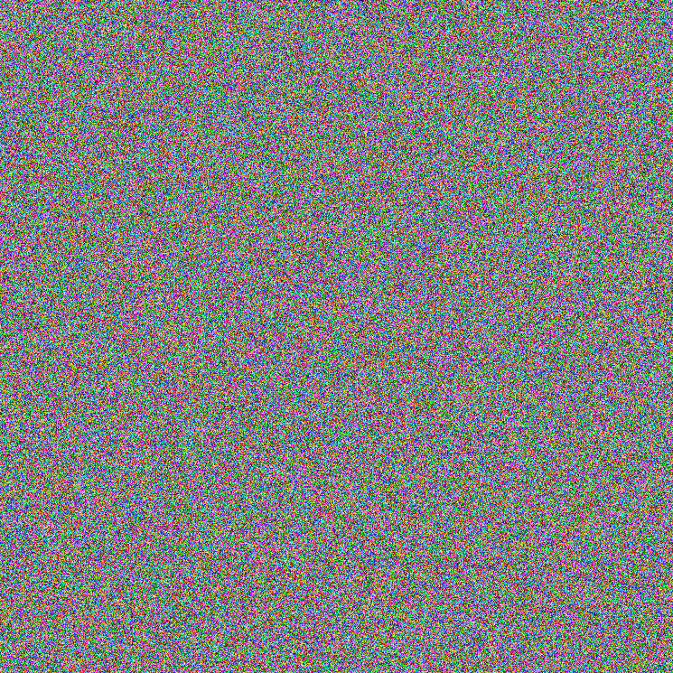

# Partie 1 : chiffrement par blocs et modes opératoires

| Question | Script | Réponse |
|---|---|---|
| Préambule | [`padding.py`](padding.py) | Fonctions `pad` / `unpad` |
| Q1, Q2 | [`q1_q2_images.py`](q1_q2_images.py) | [ci-dessous](#q1--chiffrement-dune-image-en-mode-ecb) |
| Q3 | [`q3_ecb_cpa.py`](q3_ecb_cpa.py) | [ci-dessous](#q3--preuve-dinsécurité-cpa-du-mode-ecb) |
| Q4 | [`q4_cbc_iv_predictible.py`](q4_cbc_iv_predictible.py) | [ci-dessous](#q4--attaque-cpa-sur-cbc-à-iv-prédictible) |
| Q5 | — | [ci-dessous](#q5--modes-opératoires-utilisés-sur-le-web-tls) |

| Original | ECB | CBC |
|---|---|---|
|  |  |  |

## Q1 : chiffrement d'une image en mode ECB

Les 3 lignes d'en-tête PPM (format `P6`, dimensions, valeur max) restent en clair, donc
l'image s'ouvre normalement. Seuls les octets de pixels sont chiffrés avec AES-ECB.

**Observation :** la silhouette de Tux reste parfaitement reconnaissable. Les grandes zones
de couleur uniforme sont remplacées par des motifs répétitifs, mais les contours sont conservés.

**Explication :** ECB chiffre chaque bloc de 16 octets indépendamment et de façon
déterministe. Deux blocs de pixels identiques donnent deux blocs chiffrés identiques, donc
la structure de l'image fuit.

## Q2 : chiffrement d'une image en mode CBC

**Observation :** l'image est un bruit uniforme. On ne distingue plus rien de Tux.

**Comparaison avec ECB :** en CBC, chaque bloc est XORé avec le chiffré précédent (le premier
avec l'IV) avant AES : `C_i = AES_k(M_i ⊕ C_{i-1})`. Deux blocs de pixels identiques donnent
donc des chiffrés différents. Et comme l'IV est aléatoire, chiffrer deux fois la même image
donne deux résultats différents. Aucune structure ne fuit.

## Q3 : preuve d'insécurité CPA du mode ECB

En ECB, `M = M1 ‖ … ‖ Mt` est chiffré en `C = AES_k(M1) ‖ … ‖ AES_k(Mt)`. Le chiffrement est
déterministe et bloc par bloc, donc `Mi = Mj ⇒ AES_k(Mi) = AES_k(Mj)`.

**Adversaire A :**
1. A envoie `m0 = X ‖ X` (deux blocs identiques) et `m1 = X ‖ Y` avec `X ≠ Y`.
2. Le challenger renvoie `c* = Enc_k(m_b) = c*_1 ‖ c*_2`.
3. A répond `b' = 0` si `c*_1 = c*_2`, sinon `b' = 1`.

**Analyse :**
- Si `b = 0` : `c*_1 = AES_k(X) = c*_2`, donc A répond 0.
- Si `b = 1` : AES_k est une permutation (injective) et `X ≠ Y`, donc `c*_1 ≠ c*_2` et A répond 1.

A gagne avec probabilité **1**, sans même utiliser l'oracle. AES-ECB n'est donc pas CPA-sûr.
Le script simule 1000 parties et l'adversaire les gagne toutes.

## Q4 : attaque CPA sur CBC à IV prédictible

Premier bloc CBC : `c = AES_k(iv1 ⊕ M1)` avec `M1 = "turn to page 01"` complété par un octet `\0`.

`iv1 ⊕ iv2 = 00…00 03 00` : seul l'avant-dernier octet change (`0x14 → 0x17`).

On choisit `m0` tel que `iv2 ⊕ m0 = iv1 ⊕ M1`, soit `m0 = M1 ⊕ iv1 ⊕ iv2` :
`'1' (0x31) ⊕ 0x03 = '2' (0x32)`, donc

- **m0 = "turn to page 02"**
- **m1 = "turn to page 01"** (ou n'importe quel autre message de 16 octets)

Alors `Enc_k(m0)` sous `iv2` vaut `AES_k(iv2 ⊕ m0) = AES_k(iv1 ⊕ M1) = CBC_ciphertext`, qu'on
connaît déjà. **Stratégie :** si `c* = CBC_ciphertext` alors `b' = 0`, sinon `b' = 1`. On gagne à coup sûr.

## Q5 : modes opératoires utilisés sur le Web (TLS)

| Site | Protocole | Suite cryptographique | Chiffrement | Mode |
|---|---|---|---|---|
| www.google.com | TLS 1.3 | `TLS_AES_256_GCM_SHA384` | AES-256 | GCM |
| fr.wikipedia.org | TLS 1.3 | `TLS_AES_128_GCM_SHA256` | AES-128 | GCM |
| github.com | TLS 1.3 | `TLS_AES_128_GCM_SHA256` | AES-128 | GCM |

Les trois sites utilisent AES en mode **GCM** (Galois/Counter Mode) : le mode CTR pour le
chiffrement, plus un tag d'authentification calculé dans le corps de Galois. GCM chiffre et
garantit l'intégrité en même temps. SHA256/SHA384 dans le nom de la suite sert à la dérivation
des clés, pas au chiffrement.

On ne voit ni ECB ni CBC. ECB n'est pas CPA-sûr (Q3), et CBC a été retiré de TLS 1.3 à cause
des attaques sur le padding et les IV prédictibles (comme en Q4).
